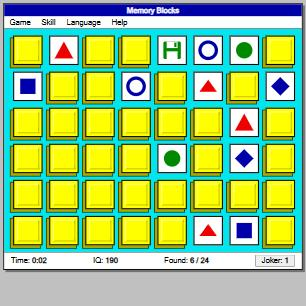

# 🟨 Memory Blocks

**A retro memory game inspired by the classic Windows 3.x _Symantec Memory Blocks_.**
Flip the yellow blocks, find the pairs, and find out how good your memory really is.

### [▶ Play online](https://svetlyobg.github.io/memory-blocks/)

English · [Български](#-български)

---

## ✨ Features

- 🖥️ **Retro look.** Yellow 3D blocks on a cyan board, styled after the 90s Windows original.
- 🎚️ **Three skill levels.** Easy (6×5), Medium (8×6) and Hard (10×6).
- 👀 **Memorize phase.** All tiles are shown at the start (7 / 9 / 11 s) with a countdown.
- 🧠 **IQ points.** Start at 100, earn points for matches and streaks, lose points for forgetting.
- 🃏 **Jokers.** Every 5 pairs you find earns a Joker that finds a random pair for you.
- 🏆 **A title at the end.** From *Goldfish* up to *Genius*, based on how accurate you were.
- 🔊 **Sound effects.** Generated in the browser, no audio files needed.
- 📱 **Mobile friendly.** Tiles resize to fit the screen, and the grid turns upright on phones in portrait.
- 🌍 **Two languages.** English and Bulgarian.
- 💾 **Remembers your settings.** Level, language and options are saved in the browser.
- 📦 **One file.** No install, no build step, no dependencies. Just `index.html`.

## 🎮 How to play

1. Watch the board while all tiles are shown. Memorize as many as you can!
2. Flip two blocks at a time.
3. If the pictures match, the pair is found. If not, both blocks flip back.
4. Find all pairs as fast as you can, with as few tries as you can.

### 🧠 Scoring

| Event | IQ points |
|---|---|
| Starting score | **100** |
| Correct pair | **+10**, plus **+2** for each pair in your current streak |
| Wrong pair | **−3** |
| …and you flip a card you had already seen | an extra **−5** per card |
| Pair found by a Joker | no points |

Your end title is based on accuracy (pairs found ÷ tries), so it's fair on every level:

**Genius** → Excellent memory → Good memory → Average memory → **Goldfish** 🐟

### ⚙️ Options (Game menu)

| Option | Default | What it does |
|---|---|---|
| Sound | on | Sound effects for flips, matches, misses and the win |
| Vanishing pairs | on | Found pairs fade away and leave empty spaces |
| Show tiles at start | on | The memorize phase at the start of each game |

## 🚀 Run it locally

Download [`index.html`](index.html) and open it in any modern browser. That's it.

## 🙏 Credits

Inspired by **Symantec Memory Blocks** for Windows 3.x.
You can try the original in your browser on the [Internet Archive](https://archive.org/details/BLOCKS_201612).
This project is a fan-made recreation and is not affiliated with Symantec.

---

## 🇧🇬 Български

**Ретро игра на памет по класическата Windows 3.x игра _Symantec Memory Blocks_.**
Обръщай жълтите блокове, намирай двойките и провери колко добра е паметта ти.

### [▶ Играй онлайн](https://svetlyobg.github.io/memory-blocks/)

### Възможности

- 🖥️ **Ретро вид.** Жълти 3D блокове на циан фон, като в оригинала от 90-те.
- 🎚️ **Три нива.** Лесно (6×5), Средно (8×6) и Трудно (10×6).
- 👀 **Показване в началото.** Всички плочки се показват за 7 / 9 / 11 секунди с обратно броене.
- 🧠 **IQ точки.** Започваш със 100, печелиш за верни двойки и серии, губиш, когато забравиш.
- 🃏 **Жокер.** На всеки 5 отгатнати двойки получаваш Жокер, който сам намира двойка.
- 🏆 **Титла в края.** От *Златна рибка* до *Гений*, според точността ти.
- 🔊 **Звуци.** Генерирани в браузъра, без аудио файлове.
- 📱 **Работи и на телефон.** Плочките се смаляват според екрана.
- 🌍 **Два езика.** Български и английски.
- 💾 **Помни настройките.** Ниво, език и опции се пазят в браузъра.

### Как се играе

1. Запомни плочките, докато са показани в началото.
2. Обръщай по два блока.
3. Ако картинките съвпадат, двойката е отгатната. Ако не, блоковете се затварят.
4. Намери всички двойки възможно най-бързо и с най-малко опити.

### Точки

| Събитие | IQ точки |
|---|---|
| Начало | **100** |
| Вярна двойка | **+10**, плюс **+2** за всяка двойка в текущата серия |
| Грешен ход | **−3** |
| …и обърнеш карта, която вече си виждал | още **−5** за всяка такава карта |
| Двойка, намерена с Жокер | без точки |

Вдъхновено от **Symantec Memory Blocks** за Windows 3.x. Това е любителски проект, несвързан със Symantec.
